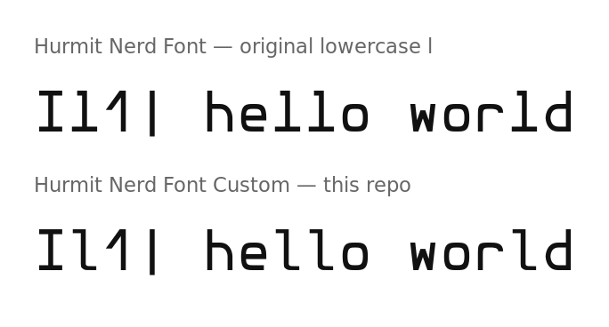

# bitter-hurmit

[Hurmit Nerd Font](https://github.com/ryanoasis/nerd-fonts) (Hermit, patched by
Nerd Fonts) with the lowercase `l` replaced by the one from Liberation Mono.



Top: original `l`, a stem with a straight bottom foot that reads almost like an
uppercase `L`. Bottom: this build, using Liberation Mono's `l` (top-left serif
and curved bottom hook).

## Why

Hermit's lowercase `l` ends in a straight horizontal foot, which makes it easy
to confuse with `L` when scanning terminal output. Liberation Mono's `l` is
distinct at a glance. It is fitted to Hermit's metrics rather than dropped in
raw:

- scaled to Hermit's ascender height (750 units on a 1000 UPM grid),
- matched stem weight (Liberation's 180/2048 ≈ Hermit's 90/1000),
- centered in Hermit's 618-unit monospace cell,
- italic faces sheared to Hermit's 10° slant.

Only the `l` glyph is changed. All Nerd Font icons, metrics and other glyphs
are untouched. Regular, Bold, Italic and Bold Italic are patched; Light and
Light Italic keep the original `l` and are not shipped.

The family is renamed **Hurmit Nerd Font Custom** so it can live next to the
packaged Hurmit Nerd Font and so no OFL reserved font name is used.

## Install

```sh
mkdir -p ~/.local/share/fonts/HurmitNerdFontCustom
cp fonts/*.otf ~/.local/share/fonts/HurmitNerdFontCustom/
fc-cache -f ~/.local/share/fonts/HurmitNerdFontCustom
```

Select `Hurmit Nerd Font Custom` in your terminal:

| Terminal | Setting |
| --- | --- |
| foot | `font=Hurmit Nerd Font Custom:size=11` |
| kitty | `font_family Hurmit Nerd Font Custom` |
| alacritty | `family = "Hurmit Nerd Font Custom"` |
| ghostty | `font-family = "Hurmit Nerd Font Custom"` |

Foot note: foot reads fonts when its server starts. Close all foot windows
before opening a new one.

## Rebuild

Needs the Arch packages `otf-hermit-nerd` and `ttf-liberation`, plus
[fonttools](https://github.com/fonttools/fonttools):

```sh
python -m pip install fonttools
python scripts/patch_hurmit.py --out fonts
```

The script reads the packaged originals from `/usr/share/fonts`, imports
Liberation Mono's `l`, and writes the renamed family to `--out`.

## License

SIL Open Font License 1.1. See [LICENSE](LICENSE) for the license text and
[NOTICE.md](NOTICE.md) for attribution.
